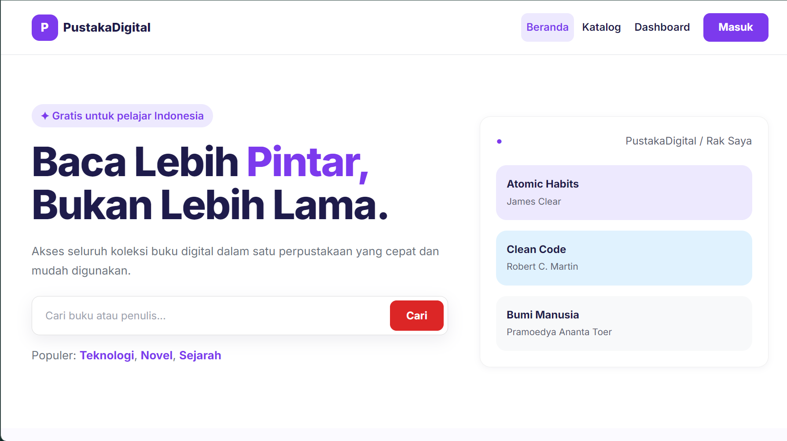
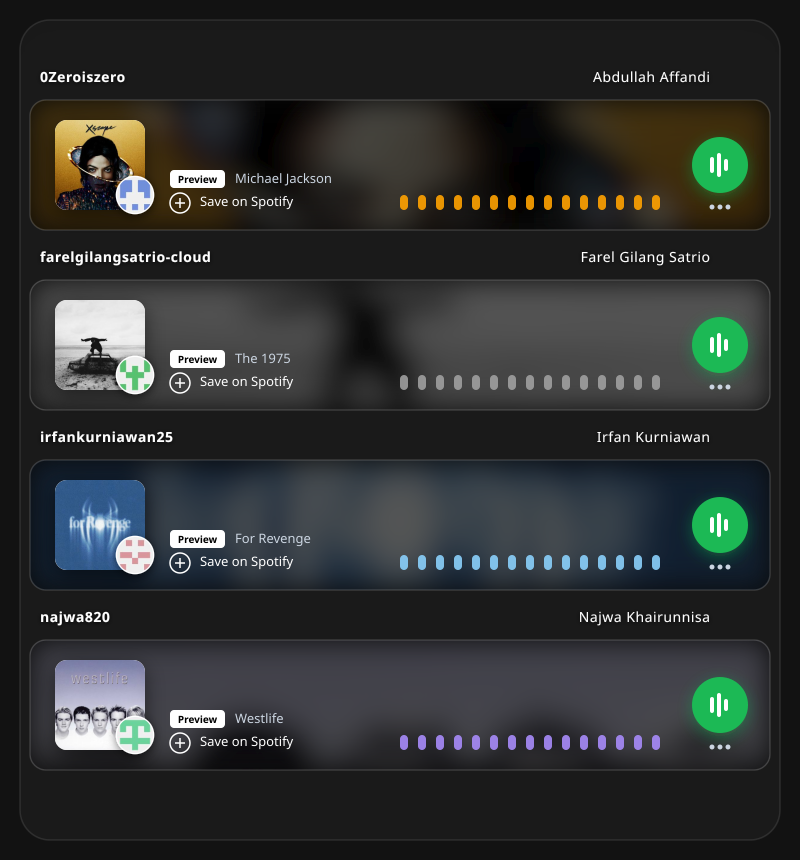

# Anggota Kelompok

# Tentang Proyek

**PustakaDigital** adalah perpustakaan digital berbasis web yang dikembangkan untuk menjawab kebutuhan akan akses koleksi bacaan yang lebih cepat, praktis, dan terorganisir. Seluruh koleksi pada sistem ini berupa **buku digital (e-book)** yang dibaca langsung dari browser, sehingga tidak ada koleksi fisik, peminjaman, maupun pengembalian buku cetak.

PustakaDigital hadir sebagai solusi dengan menyediakan katalog buku, fitur pencarian, halaman detail buku, serta penyimpanan buku ke rak pribadi. Sistem ini juga dilengkapi dengan **dashboard user** dan **dashboard admin** untuk mendukung pengelolaan koleksi yang lebih efisien.

---

## Latar Belakang

1. Perkembangan teknologi mendorong layanan perpustakaan beralih ke bentuk digital.
2. Perpustakaan konvensional terbatas oleh jam buka, lokasi, dan jumlah salinan buku cetak, sehingga koleksi tidak selalu bisa diakses kapan saja.
3. Proses peminjaman dan pengembalian buku fisik menambah langkah manual bagi pengguna maupun pengelola.
4. Pengguna membutuhkan bacaan yang cepat dicari dan bisa dilanjutkan kapan saja langsung dari browser.
5. Karena itu PustakaDigital dikembangkan sepenuhnya sebagai perpustakaan digital: koleksinya e-book, tanpa koleksi fisik, peminjaman, maupun pengembalian buku cetak.
6. Sistem menyediakan katalog, pencarian, detail buku, dan rak pribadi, serta dashboard user dan admin untuk mendukung pengelolaan koleksi.

---

## Tujuan

- Menyediakan akses koleksi e-book kapan saja, tanpa terikat jam buka atau kunjungan fisik.
- Mempermudah pengguna menemukan buku melalui pencarian judul/penulis dan filter kategori.
- Mempermudah pengguna menyimpan buku ke rak pribadi serta melanjutkan bacaan.
- Mempermudah admin mengelola data buku dan data pengguna dalam satu tempat.
- Menghilangkan proses manual khas perpustakaan fisik, seperti peminjaman, pengembalian, dan denda, karena seluruh koleksinya digital.
- Menyediakan sistem perpustakaan yang cepat, praktis, dan terstruktur.

---

## Fitur

### 🏠 Beranda
Halaman utama sebagai pintu masuk ke koleksi:
- Dua pintu masuk utama: **Katalog Buku** dan **Rak Saya**
- Pencarian langsung dari hero, kata kuncinya diteruskan ke katalog (`katalog.php?q=...`)
- Tautan kategori populer (`katalog.php?kategori=...`)

### 📚 Katalog Buku
Halaman untuk menemukan buku favorit dengan fitur:
- Pencarian berdasarkan judul atau penulis
- Filter kategori: Semua, Pengembangan Diri, Teknologi, Novel, Sejarah
- Pengurutan koleksi (Terbaru, Judul A-Z, Rating Tertinggi)
- Kartu buku berisi judul, penulis, rating, kategori, dan status ketersediaan
- Hasil pencarian dan filter bisa dibagikan lewat URL

### 📖 Detail Buku
Halaman detail buku yang menampilkan:
- Sampul dan judul buku
- Nama penulis
- Rating buku
- Deskripsi singkat
- Informasi penerbit, tahun terbit, dan jumlah halaman
- Aksi: **Simpan ke Rak** dan **Baca Buku** (membuka berkas e-book PDF)

### 🗂️ Rak Saya
Koleksi buku digital pribadi pengguna:
- Progres bacaan tiap buku
- Lanjut baca atau hapus buku dari rak
- Tampilan kosong yang mengarahkan pengguna ke katalog

### 🏠 Dashboard User
Ringkasan aktivitas membaca pengguna, meliputi:
- **Rak Saya** – jumlah buku tersimpan
- **Sedang Dibaca** – buku dengan progres bacaan
- **Selesai Dibaca** – daftar buku yang telah selesai
- **Aktivitas Terbaru** – log aktivitas pengguna

### 🛠️ Dashboard Admin
Panel khusus admin untuk mengelola sistem PustakaDigital:
- **Dashboard** – ringkasan aktivitas sistem
- **Kelola Buku** – tambah, ubah, dan hapus data buku
- **Kelola Pengguna** – manajemen akun pengguna
- **Katalog** – melihat katalog buku
- **Keluar** – logout dari sistem

### 🔐 Login
Halaman autentikasi memvalidasi email + password terhadap akun yang terdaftar. Tidak ada pendaftaran dan tidak ada pilihan peran: peran mengikuti akun, sehingga login langsung diarahkan ke dashboard yang sesuai (user atau admin). Halaman dashboard hanya terbuka setelah login, dan halaman admin menolak akun user. Dropdown "Akun demo" di atas card login menampilkan email admin/user untuk mengisi form sekaligus.

---

## Teknologi

- HTML, CSS, dan JavaScript vanilla (tanpa build step)
- Bootstrap 5.3 + Bootstrap Icons (CDN)
- Google Fonts: Inter

---

## Catatan Aksesibilitas & UI

- Setiap kolom input punya `<label for>` yang terhubung; ikon dekoratif diberi `aria-hidden="true"`, dan tombol ikon punya nama aksesibel.
- Fokus keyboard selalu terlihat, dan animasi mengikuti `prefers-reduced-motion`.
- Ukuran huruf serta padding/margin menyesuaikan saat layar mengecil.
- Warna tema diatur lewat token di `assets/css/root.css`.

---

## Future Release

Fitur-fitur yang direncanakan untuk rilis mendatang:
- Integrasi backend dan basis data (data buku, pengguna, dan rak saat ini masih dummy dan hilang saat halaman dimuat ulang)
- Reader e-book terintegrasi langsung di dalam aplikasi
- Autentikasi sungguhan beserta manajemen sesi
