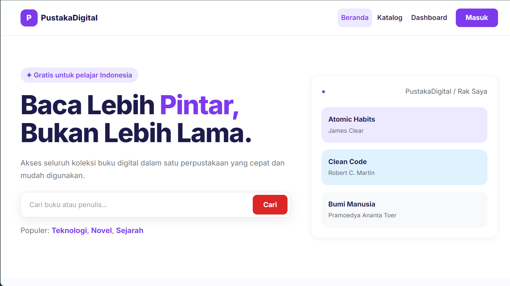
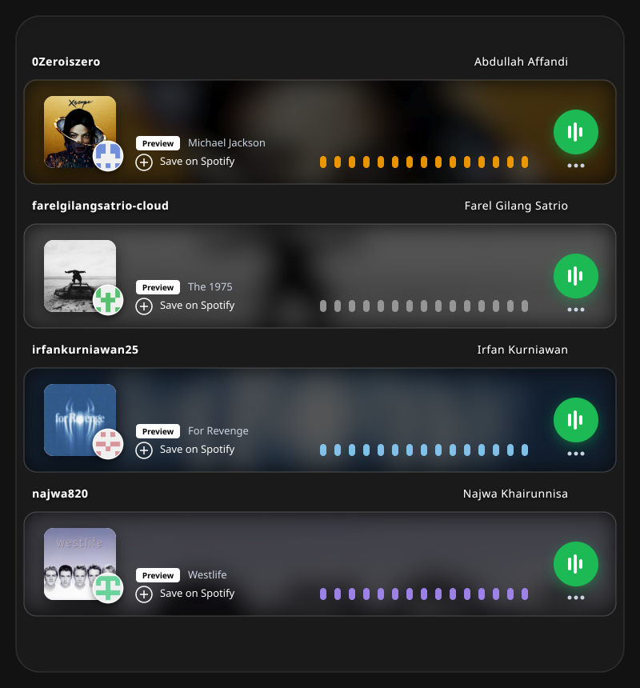

## 🔗 Demo

- **Lokal (Laragon):** <http://localhost/Perpustakaan-berbasis-web/public/>

> Akun demo — **Admin**: `admin@pustaka.com` / `admin123` · **User**: `andi@email.com` / `andi123`

# Anggota Kelompok

# Tentang Proyek

**PustakaDigital** adalah perpustakaan digital berbasis web yang dikembangkan untuk menjawab kebutuhan akan akses koleksi bacaan yang lebih cepat, praktis, dan terorganisir. Seluruh koleksi pada sistem ini berupa **buku digital (e-book PDF)** yang dibaca langsung dari browser, sehingga tidak ada koleksi fisik, peminjaman, maupun pengembalian buku cetak.

PustakaDigital hadir sebagai solusi dengan menyediakan katalog buku, pencarian, halaman detail buku, profil penulis, pembaca PDF inline, serta penyimpanan buku ke rak pribadi dengan progres baca otomatis. Sistem ini juga dilengkapi **dashboard user** dan **dashboard admin** untuk mendukung pengelolaan koleksi yang lebih efisien.

---

## Latar Belakang

1. Perkembangan teknologi mendorong layanan perpustakaan beralih ke bentuk digital.
2. Perpustakaan konvensional terbatas oleh jam buka, lokasi, dan jumlah salinan buku cetak, sehingga koleksi tidak selalu bisa diakses kapan saja.
3. Proses peminjaman dan pengembalian buku fisik menambah langkah manual bagi pengguna maupun pengelola.
4. Pengguna membutuhkan bacaan yang cepat dicari dan bisa dilanjutkan kapan saja langsung dari browser.
5. Karena itu PustakaDigital dikembangkan sepenuhnya sebagai perpustakaan digital: koleksinya e-book, tanpa koleksi fisik, peminjaman, maupun pengembalian buku cetak.
6. Sistem menyediakan katalog, pencarian, detail buku, rak pribadi, serta dashboard user dan admin untuk mendukung pengelolaan koleksi.

---

## Tujuan

- Menyediakan akses koleksi e-book kapan saja, tanpa terikat jam buka atau kunjungan fisik.
- Mempermudah pengguna menemukan buku melalui pencarian judul/penulis dan filter kategori.
- Mempermudah pengguna menyimpan buku ke rak pribadi serta melanjutkan bacaan dari halaman terakhir.
- Mempermudah admin mengelola data buku, penerbit, penulis, dan status akun dalam satu tempat.
- Menghilangkan proses manual khas perpustakaan fisik, seperti peminjaman, pengembalian, dan denda, karena seluruh koleksinya digital.
- Menyediakan sistem perpustakaan yang cepat, praktis, dan terstruktur.

---

## Fitur

### 🏠 Beranda
Halaman utama sebagai pintu masuk ke koleksi:
- Dua pintu masuk utama: **Katalog Buku** dan **Rak Saya**
- Pencarian langsung dari hero, kata kuncinya diteruskan ke katalog (`catalog.php?q=...`)
- Tautan kategori populer (`catalog.php?kategori=...`)

### 📚 Katalog Buku
- Pencarian berdasarkan judul atau penulis (modal cari dari navbar, tekan Enter)
- Filter kategori dari database (pil yang tersambung ke tabel `genres`)
- Pengurutan koleksi (Terbaru, Judul A-Z)
- Kartu buku berisi judul, penulis, kategori, dan dropdown status rak
- Hasil pencarian dan filter bisa dibagikan lewat URL

### 📖 Detail Buku & Profil Penulis
- Sampul, judul, penulis (tautan ke profil penulis), sinopsis
- Informasi kategori, tahun terbit, jumlah halaman, ISBN, dan format (PDF)
- Dropdown status rak (Akan dibaca / Sedang dibaca / Telah dibaca / Tidak Tertarik) yang langsung menyimpan
- **Baca Buku** membuka pembaca inline; pengguna belum login diarahkan ke login lalu kembali ke buku tersebut
- Profil penulis publik (`author.php?slug=...`) menampilkan bio, negara asal, dan daftar karyanya

### 📖 Pembaca PDF Inline
- PDF.js merender buku langsung di browser (`read.php?slug=...`)
- Toolbar: kembali ke detail, halaman sebelumnya/berikutnya, input halaman, zoom
- Progres `last_page` tersimpan otomatis tanpa tombol dan tanpa reload (form tersembunyi ke iframe)
- Berkas PDF dialirkan lewat `stream.php` yang menolak akses tanpa login (403)

### 🗂️ Rak Saya
- Tab empat status bacaan; menyimpan buku dari katalog/detail/profil penulis
- Progres bacaan tiap buku diturunkan dari halaman terakhir
- Lanjut baca, baca ulang, atau hapus buku dari rak (dengan konfirmasi)
- Tampilan kosong yang mengarahkan pengguna ke katalog

### 👤 Akun & Profil
- Registrasi terbuka, login email + password (hash Bcrypt), logout
- Profil mandiri: ubah nama tampilan, email, dan kata sandi
- Akun yang dinonaktifkan admin ditolak saat login dengan pesan jelas

### 🏠 Dashboard User
Ringkasan aktivitas membaca: jumlah rak, sedang dibaca, selesai dibaca, total koleksi, daftar sedang dibaca, dan aktivitas terbaru — seluruhnya dihitung dari tabel.

### 🛠️ Dashboard Admin
- Statistik buku/pengguna/penerbit/penulis serta buku terbaru
- **Kelola Buku** — tambah/edit buku (upload PDF, sampul kustom atau sampul otomatis GD), nonaktifkan/aktifkan buku
- **Master Data** — kelola penerbit dan penulis (slug otomatis)
- **Kelola Pengguna** — aktif/nonaktif akun (admin tidak dapat menonaktifkan dirinya sendiri atau admin aktif terakhir)

### 🔐 Hak Akses
Publik: beranda, katalog, detail buku, profil penulis, login, registrasi. Wajib login: rak saya, pembaca, streaming, profil, dashboard user. Wajib admin: dashboard admin dan halaman admin/*. Semua aksi tulis memakai POST + CSRF + redirect + flash.

---

## Teknologi

- PHP 8.4+ native + MySQL (mysqli, prepared statements)
- Session PHP untuk login/logout, `password_hash()` / `password_verify()`
- HTML, CSS, dan JavaScript vanilla (tanpa build step, tanpa AJAX)
- Bootstrap 5.3 + Bootstrap Icons (CDN)
- PDF.js 3.11.174 (CDN) untuk pembaca inline
- PHP GD untuk sampul bawaan otomatis
- Google Fonts: Inter

---

## Database

Aplikasi memakai database MySQL **`optl_pustaka`** dengan tujuh tabel 3NF + satu VIEW:

- `users` — akun (email unik, hash Bcrypt, role admin/member, is_active)
- `publishers` — master penerbit (nama, kota)
- `genres` — master kategori/genre buku
- `authors` — master penulis (nama, slug unik, negara, bio)
- `books` — katalog buku (slug unik, ISBN, berkas PDF + metadata, is_active)
- `collections` — Rak Saya: empat status, unik per (user, book)
- `reading_progress` — halaman terakhir per (user, book)
- `v_books_catalog` — VIEW gabungan katalog sehingga halaman publik cukup `SELECT *` (0 JOIN)

Impor `database/optl_pustaka.sql` lewat phpMyAdmin atau `mysql -uroot < database/optl_pustaka.sql`. Berkas PDF dan sampul dummy sudah ikut di repo (`storage/ebooks/`, `public/uploads/covers/`), jadi tidak ada langkah migrasi tambahan pada clone baru. Skrip `database/migrasi_berkas.py` hanya dokumentasi historis: ia butuh folder lama `ebook/`+`cover/` dan `pypdf`, dan hanya dipakai sekali saat mengevaluasi skema awal. Koneksi default `root` tanpa password di `127.0.0.1` (lihat `includes/config.php`).

---

## Catatan Aksesibilitas & UI

- Setiap kolom input punya `<label for>` yang terhubung; ikon dekoratif diberi `aria-hidden="true"`, dan tombol ikon punya nama aksesibel.
- Fokus keyboard selalu terlihat, dan animasi mengikuti `prefers-reduced-motion`.
- Ukuran huruf serta padding/margin menyesuaikan saat layar mengecil (teruji sampai 320px).
- Warna tema diatur lewat token di `public/assets/css/root.css`; kontras teks memenuhi WCAG AA.

---

## Future Release

Fitur-fitur yang direncanakan untuk rilis mendatang:
- Pagination dan filter lanjutan pada tabel admin
- Reset password dan verifikasi email
- Logika penyaringan untuk toolbar/modal filter Rak Saya (sa ini UI saja)
